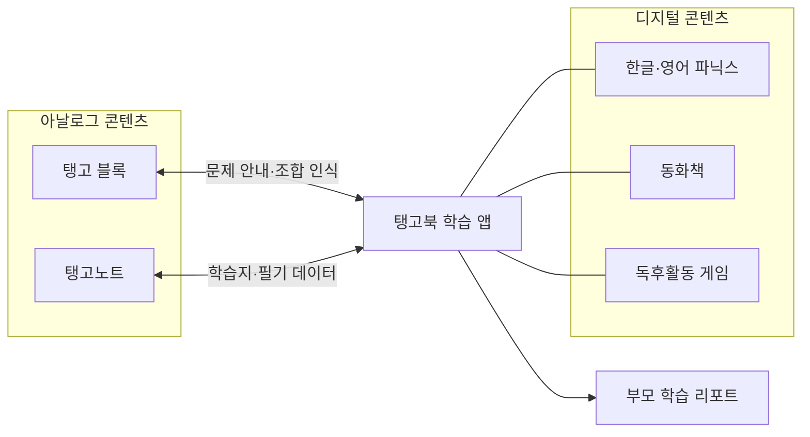

# 탱고북 플랫폼 기준 문서

기준일: 2026-10-12 · 소개서 1차 버전 기준

**탱고북은 앱의 안내에 따라 실물 블록을 조합하고 종이에 쓰며, 글자 학습에서 동화 읽기까지 이어가는 유아 언어 학습 플랫폼이다.** 한글·영어 학습 콘텐츠, 실물 교구, AI 저작도구와 마케팅 도구를 함께 운영한다. 주력 사업은 유통사를 통한 교구 패키지 공급이며, 디지털 콘텐츠와 브랜드 마케팅이 제품의 판매와 지속 사용을 뒷받침한다.

현재 플랫폼을 이해하거나 기능·상품·사업계획을 수정할 때 이 문서를 먼저 읽는다. 과거 결정과 조사 근거는 [STRATEGY.md](STRATEGY.md), 작업별 구현 상태는 [기능별 작업 지도](work/README.md)를 따른다. 현재 사용자 지시와 실제 코드·검증 결과가 문서보다 우선한다.

## 대상과 학습 가치

주 사용자는 미취학 아동이다. 부모는 제품을 선택하고 아이의 학습 현황을 확인한다. 부모에게는 학습 가치와 준비 부담의 완화, 아이에게는 직접 조작하고 다음 활동을 해보고 싶은 재미가 중요하다.

학습 범위는 **첫 글자와 소리 → 낱말 → 문장과 이야기 이해**다. 한글 중심으로 브랜드를 설명하되 한글·영어 학습 과정을 함께 제공하고, 아시아 언어로 확장한다. 어휘력과 문해력을 중심에 두며, 재미와 반복 사용을 통해 자기주도 학습을 돕는 것을 목표로 한다.

## 플랫폼 생태계

앱이 학습 안내와 콘텐츠 이용의 중심이다. 아이는 앱에서 보고 듣고, 블록이나 종이로 직접 연습하고, 게임과 동화로 배운 내용을 다시 만난다. 부모는 이 활동을 학습 기록으로 확인한다.

한글·영어 파닉스는 글자·소리·낱말의 학습 순간에 연결된 애니메이션과 사운드로 몰입감을 만든다. 누르기·쓰기·정답·완료를 구분하고, 발음의 명료함과 학습 대상의 시인성을 우선한다. 반복적인 폭죽·호리 등장 대신 말랑한 탄성, 꽃·음표·하트·리본이 학습 순간마다 다르게 움직이는 연출을 사용한다. 한글 눌러 익히기와 자모 합성은 살구색 자음·민트색 모음 그림을 사용하고, 쓰기부터는 정확한 폰트와 기존 마스크를 사용한다. [구현·검증 기록](work/phonics/tasks/20261012-learning-game-effects.md).

| 구성 | 역할 |
|---|---|
| 탱고북 학습 앱 | 학습을 안내하고, 콘텐츠·교구 활동과 학습 현황을 연결한다. |
| 탱고 블록 | 한글·영어 글자를 손으로 조합한다. 인식판과 반사경을 이용해 조합 결과를 앱에 연결한다. |
| 탱고노트 | 노트판 위 종이에 실제 펜으로 쓴다. 필기 데이터와 어떤 학습지가 놓였는지를 Bluetooth로 태블릿에 전달하는 제품 구성이다. |
| 한글·영어 파닉스 | 글자·소리에서 낱말 읽기까지 단계별로 학습한다. 권수보다 학습 과정 전체를 설명한다. |
| 동화책 | 배운 낱말을 문장과 이야기 속에서 만나고 읽기의 범위를 넓힌다. 한글·영어 동화책을 제공한다. |
| 독후활동 게임 | 듣기·찾기·순서 맞추기 등 다양한 방식으로 읽은 내용을 다시 경험한다. |
| 학습 리포트 | 앱과 교구에서 무엇을 배우고 연습했는지 부모가 한곳에서 확인한다. |

대표 흐름은 **앱에서 글자·소리 익히기 → 블록으로 조합하기 → 종이에 쓰기 → 게임으로 복습하기 → 동화 속에서 만나기 → 학습 기록 확인**이다. 모든 콘텐츠에 같은 순서를 강제하는 뜻은 아니다. 디지털 콘텐츠는 교구 없이도 이용하며, 교구는 화면 밖의 조작·필기 경험을 더한다.

통합 리포트와 교구 연동은 개발·검증 중인 범위를 포함한다. 소개서의 흐름도나 화면 시안을 실기기 연동 완료·학습 효과 검증으로 해석하지 않는다. 노출·연습·완료 기록과 실제 습득은 구분한다.

## 학습 앱의 입구

2026-10-13 학습 UX 개편 방향은 **한글 안에서 커리큘럼/자유모드, 영어 안에서 커리큘럼/자유모드**를 나누는 것이다. `/library` 첫 화면 전체를 두 모드로 나누는 뜻이 아니다. 각 언어의 커리큘럼은 처음에는 학습 시작, 기록이 생기면 이어서 학습하기로 현재 활동을 안내하며 익히기·놀이·복습을 연결한다. 아이가 안내를 따라 파닉스 전 과정을 배우게 하는 것이 목표이며, 습득 여부는 게임의 첫 선택과 힌트·재시도를 구분해 살핀다. 자유모드는 원하는 활동을 선택·반복하고 같은 자녀·언어의 학습 기록을 공유한다. 2026-10-13 사용자 적용 승인으로 언어별 모드 진입, 순차 활동·전체 단원/복습, 현재 지점 이어하기와 미래 단계 잠금을 로컬 구현했다. 기존 필수 익히기/쓰기를 보존하고 모음 묶음에는 소리 고르기 게임을 안내 과정에 포함한다. 단계 완료는 활동 완료 기준이며 숙달 판정과 다르다. 첫 선택·재시도 관찰은 소리 고르기 게임부터 기록하고, 힌트 분류·오답별 자동 복습·숙달 기준·세계관은 후속 검토다. [방향·시안](work/phonics/tasks/20261013-phonics-world-concept.md), [실제 적용과 검증](work/phonics/tasks/20261013-phonics-learning-modes.md).

한글 과정은 **Book 1 모음 → Book 2 자음과 기본 음절 → Book 3 받침 → Book 4 쌍자음 → Book 5 복잡한 모음** 순서다. Book 1은 **ㅏ·ㅑ·ㅓ·ㅕ / ㅗ·ㅛ·ㅜ·ㅠ / ㅡ·ㅣ** 세 묶음이며, 묶음 안에서는 한 모음씩 익히고 쓴다. 듣기를 마친 모음 두 개부터 듣고 고르기·모음 찾기·같은 모음 짝 맞추기를 제공하고, 선택지는 두 개부터 최대 네 개까지 늘린다. 마지막 묶음에서는 이전에 익힌 모음도 복습한다. [후속 결정·구현](work/phonics/tasks/20261012-korean-vowel-groups.md). 모음 입문에서는 모음 자체의 모양을 쓰고, 자음과 음절 조합은 Book 2부터 다룬다. 기존 저작 책·음원·활동 ID는 호환을 위해 보존한다. 권번호 분리는 교육 구성 변경이며 기존 기본글자 무료 범위를 줄이는 결정이 아니다. [작업 기록](work/phonics/tasks/20261012-korean-vowel-book1.md).

모음 하나를 익힐 때는 같은 모음 카드3개를 나란히 두고 하나씩 눌러 소리를 듣는다. 세 카드의 발음이 끝나면 쓰기로 이어진다. 한영 파닉스의 단원 선택·학습판·파닉스 게임은 공통 풍경 배경으로 연결하고, 그림 익히기와 폰트 쓰기를 시각적으로 구분한다. [후속 디자인·소리 복구](work/phonics/tasks/20261012-phonics-playful-ui.md).

학습하기(`/library`)는 한글·영어 과정, 완료 기록에서 찾은 다음 커리큘럼 활동 이어 하기, 오늘의 추천 동화책 3권을 보여준다. 상위 탐색은 홈·한글·영어·동화책·활동이며, 동화책 찾기는 `/library/books`에서 검색·카테고리·그림풍으로 이어간다. 부모의 프로필·학습 리포트·설정은 보조 메뉴에 둔다. 블록·종이는 활동의 방식으로 안내하며 홈에서 별도 주력 축처럼 반복하지 않는다. 2026-10-12 로컬 구현 기준이며 운영 배포 상태는 [UI v2 작업 기록](work/platform/tasks/20261012-platform-ui-v2-implementation.md)을 따른다.

## 플랫폼을 만드는 구성

플랫폼 생태계가 아이와 부모의 경험이라면, 플랫폼 구성은 그 경험을 만들고 계속 공급하는 내부 역량이다.

**AI 저작도구 → 보유 콘텐츠 → 앱과 교구의 학습 경험**으로 이어지고, **같은 콘텐츠 → AI 마케팅 도구 → 유통사 판매 지원**으로 확장한다.

| 구성 | 담당하는 일 |
|---|---|
| AI 저작도구 | 동화책 텍스트, 이미지, 음성(TTS), 애니메이션, 숏폼 콘텐츠와 다국어 번역을 제작한다. 편집자가 기획·검수·수정을 담당한다. |
| 보유 콘텐츠 | 한글·영어 파닉스와 세계 명작·전래·생활·자연관찰·창작동화를 축적한다. 책·삽화·낱말·음성을 학습과 홍보에 활용한다. |
| 디지털 학습 | 파닉스, 동화 읽기, 독후활동 게임을 앱에서 제공한다. 학습과 활동의 기록을 연결한다. |
| 아날로그 학습 | 탱고 블록의 조합 인식과 탱고노트의 종이 필기를 앱 안내·피드백과 연결한다. |
| AI 마케팅 도구 | 콘텐츠별 블로그 글·카드뉴스·영상 등 홍보물을 만들고 검수·예약·자동 발행으로 이어간다. |

소개서의 콘텐츠 규모 표현은 **동화책 1,000+권, 매달 100+권 신간, 10+가지 다양한 유형의 독후활동 게임**이다. 사용자 승인 사업계획 표현이며, 실제 공개 수·언어별 제공 수·월별 발행 실적을 확인할 때는 [콘텐츠 현황판](../packages/client/public/content-status.html)과 관련 작업 기록을 사용한다. 과거 집계와 번역 수를 임의로 합산하지 않는다.

콘텐츠별 홍보물 자동 생성·발행 도구는 구축돼 있다는 사용자 설명을 기준으로 한다. 개별 채널의 연결 상태와 실제 발행 성공 여부는 마케팅 작업 기록에서 확인한다. AI 제작에는 사람의 검수·수정과 운영 비용이 포함된다.

## 판매 구조와 역할

**주력 판매 경로는 탱고북 → 유통사 → 인플루언서 공동구매 → 소비자다.** 초기에는 이미 거래 관계가 있는 공동구매 전문 유통사를 활용한다. 예상 판매량은 당사가 유통사에 공급하는 수량을 기준으로 잡는다.

| 주체 | 역할 |
|---|---|
| 탱고북 역할 1 | 제품과 콘텐츠를 만들고 유통사에 공급한다. |
| 탱고북 역할 2 | 브랜드와 오가닉 마케팅을 운영해 유통사가 잘 팔 수 있도록 지원한다. |
| 유통사 | 인플루언서 공동구매를 운영하고 소비자에게 판매한다. 판매 결과에 따라 당사에 재주문한다. |
| 소비자 | 제품을 구매해 사용하고, 만족한 경험을 후기와 추천으로 공유할 수 있다. 입소문은 성장 가설이다. |

네이버 블로그, Google SEO, YouTube, Instagram 등의 오가닉 콘텐츠는 제품 이해와 검색 확인, 후기·추천을 돕는다. 초기 전략은 오가닉 브랜드 마케팅 중심이며 유료 광고를 기본 판매 전제로 두지 않는다.

자사몰은 정가 판매를 유지해 공식 상품·가격을 확인하는 기준점이 된다. 자사몰 할인으로 유통사의 공동구매 판매와 경쟁하지 않는다. 한글 중심 브랜딩은 유지하되 오가닉 콘텐츠의 소재는 동화·영어·제품 사용 경험 등 플랫폼 전체로 넓힌다.

## 상품과 수익 기준

주력 상품명은 **블록 세트 + 프리미엄 12개월 이용권**이다. 한글·영어 블록, 인식판, 반사경·거치대와 디지털 이용권을 묶는다. 태블릿은 포함하지 않는다. 탱고노트는 별도 상품이다.

| 사업계획 기준 | 블록 패키지 | 탱고노트 |
|---|---:|---:|
| 소비자가 | 139,000원 | 100,000원 |
| 정가 대비 공급률 | 50% | 50% 가정 |
| 당사 공급가 | 69,500원 | 50,000원 |
| 교구 원가 | 10,000원 가정 | 20,000원 |
| 플랫폼 비용 | 12개월 합계 10,000원 가정 | 추가 비용 0원 가정 |
| 대당 매출총이익 | 49,500원 | 30,000원 |

가격·원가는 현재 사업계획 기준이다. 매출총이익은 공급가에서 교구 원가와 플랫폼 비용을 뺀 관리용 계산이며 순이익과 다르다. 배송·반품·인건비 등 추가 비용은 별도다. 탱고노트의 구독 포함 여부와 최종 구성은 미정이다.

포함된 12개월 이용권 매출을 블록 매출에 다시 더하지 않는다. 소개서 매출 전망은 **블록 유통사 공급만 반영하며 탱고노트 판매는 제외**한다. 자사몰 주문과 유통사의 소비자 판매량도 중복 합산하지 않는다. 구독은 디지털 단독 이용의 선택지이며 주력 판매 구조를 대신하지 않는다.

가격·원가·공급량을 변경할 때는 [소개서의 매출 시뮬레이션](../packages/client/public/tangobook-business-plan.html#simulation)과 [초기 판매 계획](marketing/drafts/business-plan-sales-20261011.cjs)을 함께 맞춘다.

## 출시와 확장 계획

| 시기 | 계획 |
|---|---|
| 2027년 1분기 | 한국 출시. 탱고북 v1.0과 탱고 한글·영어 블록 패키지 공급. |
| 2027년 3분기 | 탱고노트 출시. 종이 쓰기 학습 연동 확장. |
| 2028년 | 태국·베트남·인도네시아 3개국 출시, 탱고북 v2.0과 다양한 블록 확장. |

2027년 블록 유통사 공급 목표는 10,500세트다. 시뮬레이션 초기 계획은 1분기 1,500세트, 이후 분기별 3,000세트이며, 공급 매출 약 7.3억원·매출총이익 약 5.2억원이다. 목표를 실제 계약·판매 실적으로 사용하지 않는다. 2028년 공급량과 탱고노트 물량은 미정이다.

언어 확장 후보는 베트남어·태국어·말레이어·몽골어·중국어·일본어다. 언어 후보 목록과 첫 출시 국가 세 곳은 서로 다른 계획이다. 현지어 파닉스는 번역 외에도 문자·소리·학습 순서의 설계와 검수가 필요하다.

추가 블록은 숫자·연산, 창의, 보드게임 등의 확장 계획이다. 이것만으로 현재 앱이 전과목 학습을 제공한다고 설명하지 않는다. 투자 금액·집행 비율·팀 구성, 양산 상세와 실기기 검증은 별도로 확정한다.

## 소개서와 작업 문서 사용법

대외 설명은 **시장 배경 → 탱고북 플랫폼 생태계 → 탱고북 플랫폼 구성 → 사업화 전략** 순서다. 생태계만 읽어도 제품과 사용 경험을 이해할 수 있어야 하며, 플랫폼 구성은 제작·공급·운영 역량을 뒷받침한다.

| 확인할 내용 | 기준 문서 |
|---|---|
| 현재 플랫폼의 전체 구조와 사업 방향 | 이 문서 |
| 과거 결정·경쟁 조사·변경 이유 | [전략 결정 기록](STRATEGY.md) |
| 실제 제품 기능·검증·남은 작업 | [기능별 작업 지도](work/README.md)와 해당 영역 BRIEF·MEMORY·task |
| 대외 설명과 시뮬레이션·판매 상세 | [탱고북 소개서](../packages/client/public/tangobook-business-plan.html), [운영 주소](https://www.tangobook.co.kr/tangobook-business-plan.html) |
| 소개서 편집·승인 내역 | [1차 버전 작업 기록](work/strategy/tasks/20261010-unified-business-plan.md) |
| 소개서 생성·배포 | [HTML 생성기](marketing/drafts/build-investor-plan-20261010.cjs), [로딩 최적화 기록](work/strategy/tasks/20261011-introduction-loading.md) |

플랫폼 방향이 바뀌면 이 문서의 해당 절을 현재 상태로 갱신하고, 변경 이유를 STRATEGY.md와 관련 작업 기록에 남긴다. AGENTS.md와 CLAUDE.md에는 상세 내용을 복사하지 않고 이 문서를 연결한다. 과거의 무료 범위·가격 미정·구독 중심·옛 탭 구성 같은 기록이 현재 승인된 상품·유통 전략을 덮어쓰지 않도록 한다.

소개서 HTML은 이미지·폰트를 `packages/client/public/business-plan-assets/`에서 불러온다. HTML과 자산 폴더를 함께 배포한다. 문구·그림 수정은 생성기와 관련 모듈에 반영하며, 생성된 HTML만 고치지 않는다. 단일 파일 공유는 PDF를 사용한다.
